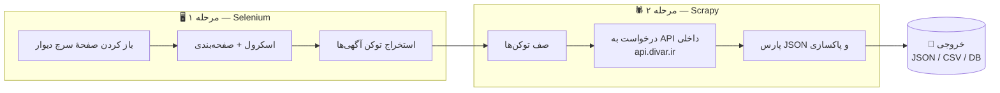
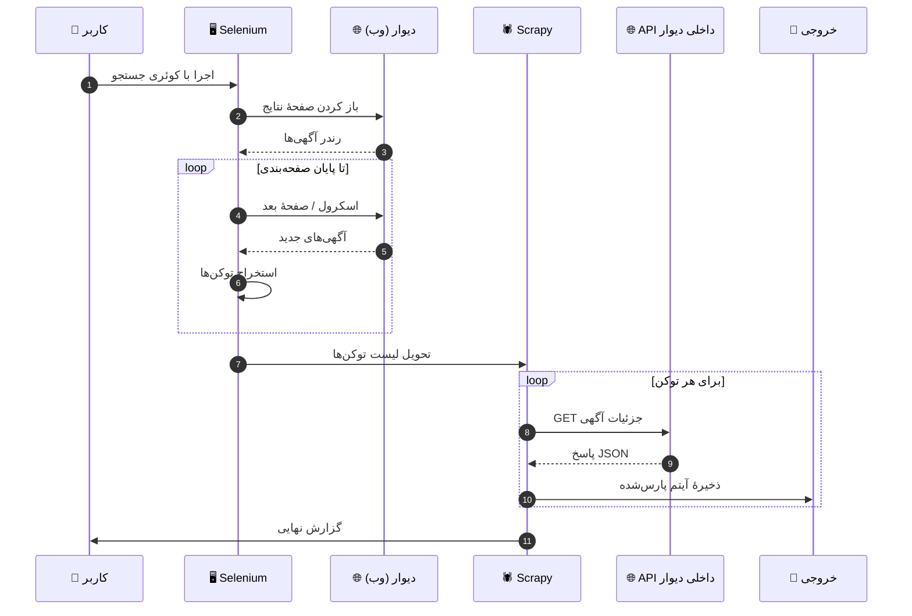

<div align="center">

# 🏙️ Divar Scraper

**جمع‌آوری آگهی‌های دیوار — سلنیوم برای صفحهٔ سرچ + Scrapy برای API داخلی**


</div>

---

## 📖 معرفی

**Divar Scraper** یک ابزار ترکیبی برای جمع‌آوری آگهی‌های سایت [دیوار](https://divar.ir) است.

صفحهٔ جستجوی دیوار به‌صورت داینامیک با جاوااسکریپت رندر می‌شود؛ بنابراین از **Selenium** برای باز کردن صفحهٔ سرچ، هندل کردن اسکرول و صفحه‌بندی و استخراج **توکن آگهی‌ها** استفاده می‌کنیم. سپس **Scrapy** با فراخوانی مستقیم **API داخلی دیوار**، جزئیات کامل هر آگهی را به‌صورت JSON و با سرعت بالا دریافت، پارس و ذخیره می‌کند.

### چرا ترکیب Selenium + Scrapy؟

| ابزار | نقش | دلیل انتخاب |
|---|---|---|
| 🖥️ **Selenium** | صفحهٔ جستجو | رندر جاوااسکریپت، اسکرول بی‌نهایت، صفحه‌بندی، استخراج توکن‌ها |
| 🕷️ **Scrapy** | جزئیات آگهی‌ها | فراخوانی مستقیم API داخلی، سرعت بالا، Concurrency و Pipeline |

---

## 📋 فهرست مطالب

- [معماری پروژه](#-معماری-پروژه)
- [جریان کار](#-جریان-کار)
- [ساختار پروژه](#-ساختار-پروژه)
- [نصب و راه‌اندازی](#️-نصب-و-راهاندازی)
- [نحوهٔ استفاده](#-نحوهٔ-استفاده)
- [نمونهٔ خروجی](#-نمونهٔ-خروجی)
- [وضعیت توسعه](#-وضعیت-توسعه)
- [رفع اشکال](#️-رفع-اشکال)
- [سلب مسئولیت](#️-سلب-مسئولیت)

---

## 🏗️ معماری پروژه



---

## 🔁 جریان کار



---

## 📂 ساختار پروژه

```text
divar-scraper/
├── main.py                  # نقطهٔ شروع: اجرای سلنیوم + تحویل توکن‌ها به اسکرپی
├── config.yaml              # تنظیمات: شهر، دسته‌بندی، کوئری، تعداد صفحات
├── requirements.txt
│
├── selenium_search/         # ماژول سلنیوم
│   ├── search.py            # صفحهٔ سرچ، اسکرول، صفحه‌بندی
│   ├── token_extractor.py   # استخراج توکن آگهی‌ها
│   └── driver.py            # راه‌اندازی WebDriver
│
├── scrapy_project/          # پروژهٔ اسکرپی
│   ├── scrapy.cfg
│   └── divar/
│       ├── items.py         # مدل آگهی
│       ├── spiders/
│       │   └── post_api.py  # اسپایدر API داخلی
│       ├── pipelines.py     # پاکسازی، دیوآپلیکیت، ذخیره
│       └── settings.py      # AutoThrottle، User-Agent و ...
│
└── output/                  # خروجی‌ها
    ├── posts.json
    └── posts.csv
```

---

## ⚙️ نصب و راه‌اندازی

### پیش‌نیازها

- Python **3.10+**
- Google Chrome
- ChromeDriver (هماهنگ با نسخهٔ کروم)

### مراحل نصب

```bash
# کلون کردن مخزن
git clone https://github.com/Ali-Banibougeri/Divar-Scraper.git
cd divar-scraper

# ساخت محیط مجازی
python -m venv venv
source venv/bin/activate        # ویندوز: venv\Scripts\activate

# نصب وابستگی‌ها
pip install -r requirements.txt
```

### تنظیمات (`config.yaml`)

```yaml
search:
  city: tehran
  category: real-estate      # دسته‌بندی (مثلاً املاک)
  query: "آپارتمان"           # عبارت جستجو
  max_pages: 5               # تعداد صفحات برای سلنیوم

scrapy:
  concurrent_requests: 4
  download_delay: 1.5        # ثانیه — مهم برای جلوگیری از بلاک شدن

output:
  format: json               # json | csv | both
  file: output/posts.json
```

---

## 🚀 نحوهٔ استفاده

```bash
# اجرای کامل (سلنیوم + اسکرپی)
python main.py

# فقط اسپایدر اسکرپی با لیست توکن‌های آماده
scrapy crawl post_api -a tokens=tokens.txt -o output/posts.json

# خروجی CSV
scrapy crawl post_api -a tokens=tokens.txt -o output/posts.csv
```

---

## 📊 نمونهٔ خروجی

```json
{
  "token": "gVWbGMjX",
  "title": "آپارتمان ۸۰ متری، سعادت‌آباد",
  "price": 7450000000,
  "city": "tehran",
  "district": "سعادت‌آباد",
  "publish_date": "۱۴۰۳/۰۵/۱۲",
  "description": "پارکینگ، انباری، آسانسور ...",
  "images": ["https://s100.divarcdn.com/..."],
  "scraped_at": "2025-01-01T12:00:00"
}
```

---

## 🚧 وضعیت توسعه

> ⚠️ این پروژه در مرحلهٔ **توسعهٔ فعال** است و ممکن است ساختار آن تغییر کند.

راهنما: ✅ انجام‌شده | 🚧 در حال توسعه | 📌 برنامهٔ آینده

| قابلیت | وضعیت |
|---|:---:|
| جمع‌آوری توکن آگهی‌ها با Selenium | ✅ |
| اسکرول خودکار و صفحه‌بندی | ✅ |
| دریافت جزئیات از API داخلی با Scrapy | ✅ |
| خروجی JSON و CSV | ✅ |
| دیوآپلیکیت (حذف آگهی‌های تکراری) | ✅ |
| Rate Limit و AutoThrottle هوشمند | 🚧 |
| چرخش خودکار User-Agent | 🚧 |
| CLI کامل با آرگومان‌های ورودی | 🚧 |
| پشتیبانی از پروکسی | 📌 |
| ذخیره در دیتابیس (PostgreSQL / MongoDB) | 📌 |
| اجرای زمان‌بندی‌شده (Scheduler) | 📌 |
| اعلان تلگرام برای آگهی‌های جدید | 📌 |
| Docker | 📌 |

### 🗺️ Roadmap

- [x] استخراج توکن‌ها از صفحهٔ سرچ
- [x] اسپایدر API داخلی
- [x] Pipeline ذخیره‌سازی
- [ ] چرخش User-Agent و مدیریت بلاک
- [ ] پشتیبانی از دیتابیس
- [ ] انتشار نسخهٔ پایدار `v1.0`

---

## 🛠️ رفع اشکال

| مشکل | راه‌حل |
|---|---|
| خطای نسخهٔ ChromeDriver | نسخهٔ درایور را با نسخهٔ کروم هماهنگ کنید یا از `webdriver-manager` استفاده کنید |
| دریافت 403 از API | User-Agent واقعی‌تر تنظیم کنید و `download_delay` را افزایش دهید |
| صفحهٔ سرچ رندر نمی‌شود | حالت Headless را غیرفعال کنید یا زمان انتظار (wait) را بیشتر کنید |

---

## ⚠️ سلب مسئولیت

این پروژه صرفاً با هدف **آموزشی** ساخته شده است. جمع‌آوری داده با نرخ بالا ممکن است شرایط استفادهٔ دیوار را نقض کند. لطفاً با تأخیر منطقی بین درخواست‌ها و به‌صورت مسئولانه استفاده کنید. مسئولیت استفادهٔ نادرست بر عهدهٔ کاربر است.

---

## 🤝 مشارکت

مشارکت‌ها خوش‌آمدند! 🎉

برای گزارش باگ یا پیشنهاد قابلیت جدید، لطفاً [Issue](https://github.com/Ali-Banibougeri/Divar-Scraper/issues) باز کنید یا Pull Request بفرستید.

---

## 📄 لایسنس

این پروژه تحت لایسنس [MIT](LICENSE) منتشر شده است.
